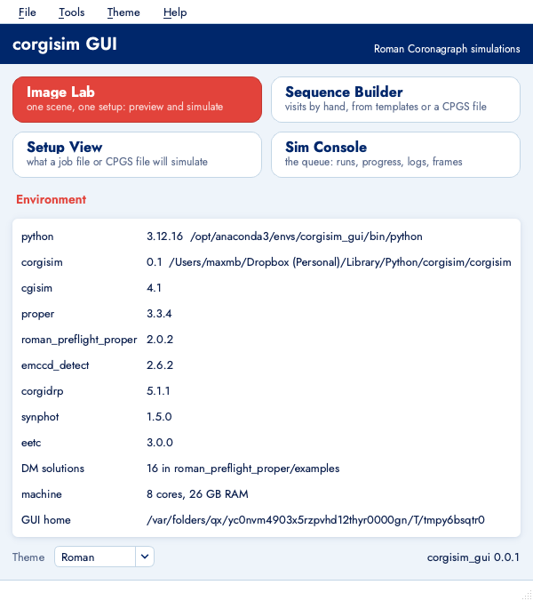
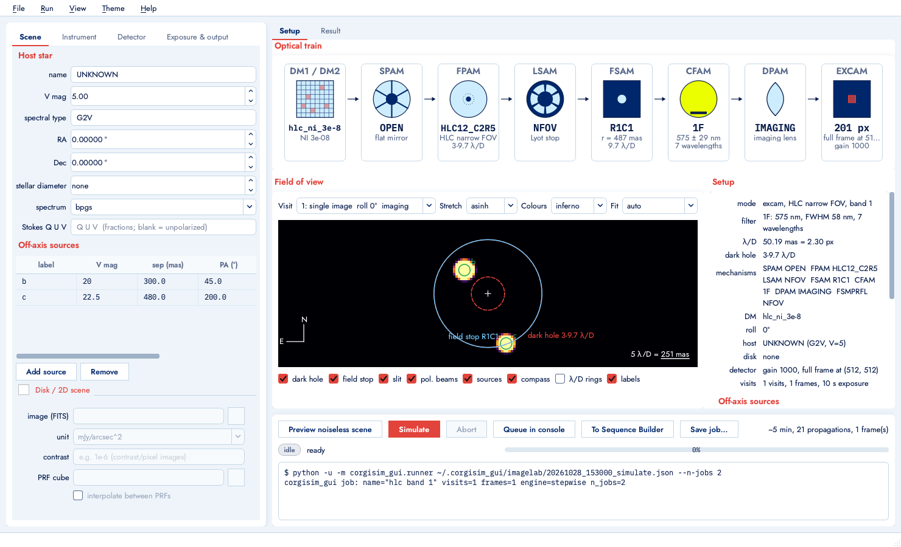
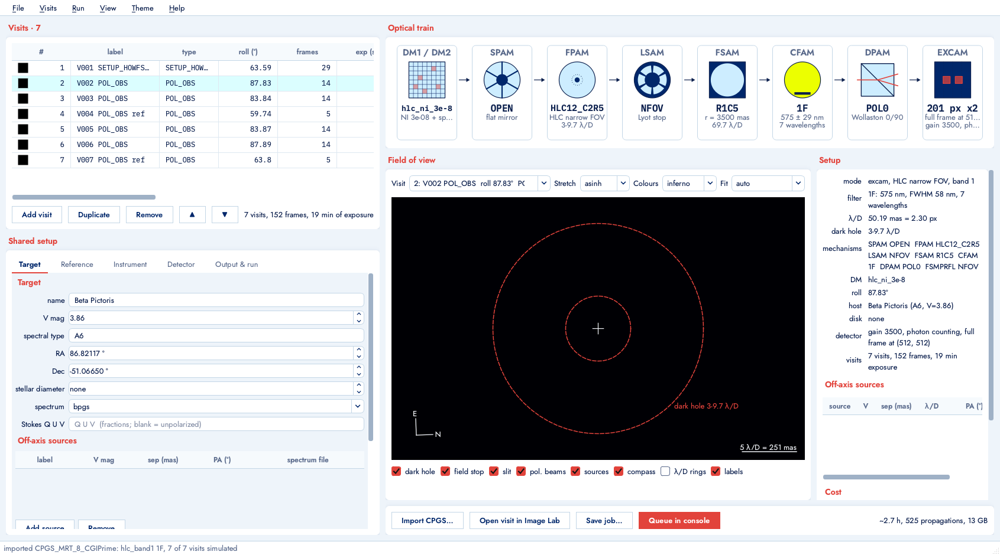
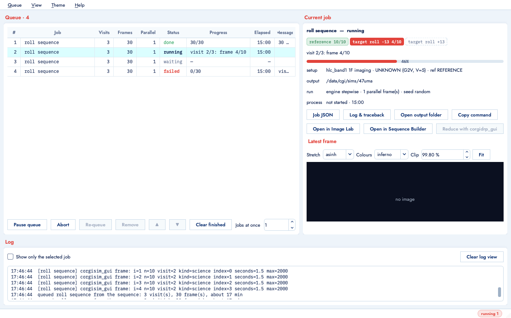
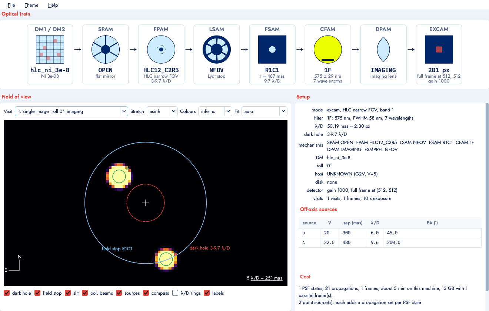

# corgisim GUI user guide

`corgisim-gui` opens the launcher. Each tile opens one tool; the tools hand work to each other
(Image Lab → Sequence Builder, either → Sim Console, Console → either).

## Image Lab

One scene, one instrument setup, one detector: the place to try a configuration.

- **Scene**: host star (V mag, spectral type, optional diameter and Stokes vector), off-axis point
  sources as a table (V mag, separation in mas, position angle east of north, optional spectrum
  file), and an optional disk image with its surface-brightness unit and PRF cube.
- **Instrument**: mode, coronagraph, filter (only the filters cgisim accepts for that
  coronagraph are offered), DPAM element, slit (spectroscopy), ND filter, roll angle, polaxis,
  which masks are in the beam, the DM solution shipped with roman_preflight_proper, image size and
  oversampling, FSM offsets, satellite spots and the jitter / stellar diameter presets.
- **Detector**: EM gain, photon-counting flag, cosmic rays, the fast gain-model switches, full
  frame placement, any other emccd_detect keyword as JSON.
- **Exposure & output**: visit type, exposure time, frames, satellite-spot frames; output folder,
  L1 naming, noiseless scene, engine, parallel frames (capped by this machine's RAM), seed.

The **Setup** tab updates as you type: the optical-train strip shows the element corgisim will
record in each mechanism's header keyword, the field of view shows the companions (as Gaussians
of the diffraction width), the disk, the dark hole, the field stop or slit and the polarimetry
beams; the facts panel lists the mechanisms, the sources, the cost estimate and the checks.
Cells and checks turn amber or red when a choice is off-nominal or invalid.

**Preview noiseless scene** propagates the scene through PROPER and shows it (no detector).
**Simulate** also runs emccd_detect and writes the frames. Both run `corgisim_gui.runner` as a
subprocess; the log at the bottom shows its output and the command line, which you can paste in
a terminal to reproduce the run. The **Result** tab lists every file the run wrote.

## Sequence Builder

A table of visits sharing one setup.

- Build visits by hand (add, duplicate, move, edit cells: roll, frames, exposure, gain,
  photon counting, DPAM element, reference flag, satellite-spot frames, visit number), from the
  templates in the File menu (reference + two rolls, polarimetry pair, rolls with satellite
  spots), or by importing a CPGS XML file.
- **Import CPGS** builds the visits the way corgisim's own loader would (same visit filter, the
  same DM-solution choice from the requested flux ratio, gains from the `cpgs_input` block,
  satellite spots from the pair id). The notes dialog lists what the file says that corgisim
  ignores (per-visit gains, orientation B slit offsets) and where corgisim misbehaves.
- The Setup View on the right follows the selected visit (its roll, DPAM element, gain and, for a
  reference visit, the reference star). The estimated time per visit is in the last column.
- **Queue in console** writes the job file into `~/.corgisim_gui/queue/` and starts it.

## Sim Console

The queue runs one job at a time by default (each job may itself simulate detector frames in
parallel). Progress comes from the runner's marker lines: visits, PSF states and frames. The
current job panel shows a chip per visit, the latest frame as it is written, the output folder
and the process state; buttons open the job JSON, the log with any traceback, the output folder,
copy the runner command, or open the job in the Image Lab or Sequence Builder. **Reduce with
corgidrp_gui** opens the output folder in corgidrp_gui's Recipe Parser when `corgidrp-gui` is on
the PATH. The queue is persisted, so waiting jobs survive a restart (running ones are marked
aborted).

## Setup View

The same strip, field and facts as a standalone window, for any job JSON or CPGS file:

## Job files and the runner

A job is a JSON file (`corgisim_gui.core.model.Job`). Every window can save one, and the runner
executes it without the GUI:

    python -u -m corgisim_gui.runner job.json [--n-jobs 2] [--seed 7] [--preview] [--validate-only]

Outputs go to `output_dir/V<visitid>/` as L1 files named `cgi_<visitid>_<time>_l1_.fits`
with corgidrp headers, plus `noiseless_V<visitid>_<state>.fits` in counts/s.

## Command line

    corgisim-gui [--theme roman] [--tool imagelab] [--job job.json] [--cpgs file.xml] [--queue job.json]
